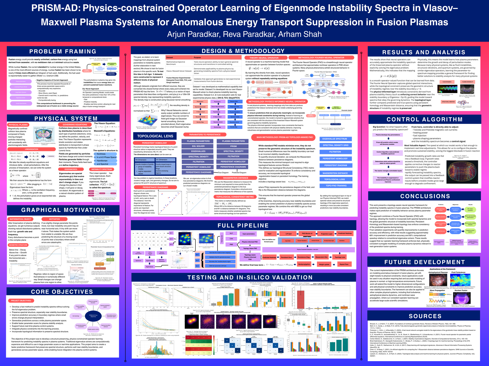

# PRISM-AD

Topology-Aware Physics-Constrained Operator Learning of Eigenmode Instability Spectra in Vlasov–Maxwell plasma systems.

**Three-dataset story (poster):**
- **Mathematical benchmark operator dataset** demonstrates structure-preserving spectral operator learning under controlled topology-changing regimes (2-cluster, 3-cluster, ring, merging; γ_max crossing zero).
- **Full Vlasov–Maxwell spectra** are generated using Gkeyll VM simulations and extracted into (ω, γ) mode spectra for training and evaluation (synthetic mode amplitudes when Gkeyll is not installed).
- **Real experimental fusion validation** uses LHD open diagnostic signals (NIFS LHD Open Data on AWS), converted into spectral density images via STFT.

**What you need:** Python 3.8+ with `numpy`, `scipy`, `torch`, `PyYAML`, `matplotlib`. Optional: `gudhi`, `persim` for true Wasserstein topology; eigenvalue solver is a surrogate to benchmark iterative eigensolver runtime vs neural inference.

**One command to get all graphs and tables (recommended):**
```bash
pip3 install -r requirements.txt   # or:  python3 -m pip install -r requirements.txt
python3 run_full_evaluation.py
```
This generates data (if missing), trains models (if missing), then produces all metrics, **results/figures/** (7 figures), and **results/tables/** (3 CSVs). No other steps needed.

**Alternative (full pipeline):**
```bash
chmod +x run_all.sh
./run_all.sh
```
Outputs: `data/<dataset_name>/processed/` (dataset.pt, meta.json, splits.json, manifest.csv), `runs/<dataset_name>/<model_name>/`, `runs/figs/<dataset_name>/`, `runs/results/<dataset_name>/metrics_table.csv`, `runs/results/all_datasets_metrics.csv`.

**Per-dataset quickstart:**
```bash
python scripts/gen_data_dataset.py --config configs/data_benchmark.yaml
python scripts/train_model_dataset.py --config configs/train_mlp.yaml --dataset benchmark_operator
python scripts/eval_all_datasets.py --datasets benchmark_operator
python scripts/make_figs_dataset.py --datasets benchmark_operator
```
**Gkeyll:** `./scripts/setup_gkeyll.sh` to set `GKEYLL_BIN`. **LHD:** `./scripts/fetch_lhd_data.sh` to download from AWS (optional).

---

## Where to find your results

After running `./run_all.sh` (or the per-dataset commands):

| What you want | Where it is |
|---------------|--------------|
| **Graphs / figures** | `runs/figs/<dataset_name>/` — e.g. `runs/figs/benchmark_operator/01_density_mapping.png`, `02_cloud_to_density.png`, `03_regime_gallery.png`, `04_stability_boundary_hist.png`, `05_truth_pred_diff_grid.png`, `06_model_comparison_heatmap.png`, `07_wasserstein_barchart.png`, `08_boundary_stress.png`, `09_persistence_diagrams.png`, `10_train_curve_*.png`, `11_manifest_preview.png` |
| **Tables (metrics)** | `runs/results/<dataset_name>/metrics_table.csv` — val_mse, boundary_mse, ood_mse, gamma_max_err, W0, W1, TopoDist per model. Combined: `runs/results/all_datasets_metrics.csv` (all datasets × models) |
| **Tables (dataset)** | `data/<dataset_name>/processed/manifest.csv` (one row per sample). Benchmark only: `runs/results/benchmark_operator/regimes_table.csv`, `runs/results/benchmark_operator/dataset_summary.csv` |
| **Model outputs (predictions)** | `runs/<dataset_name>/<model_name>/eval_preds.pt` — contains `val_preds` and `val_truths` (numpy arrays) for that model on that dataset |
| **Model checkpoints & curves** | `runs/<dataset_name>/<model_name>/checkpoint.pt`, `train_curve.png`, `val_curve.png`, `summary.json`, `eval_metrics.json` |
| **Dataset artifacts** | `data/<dataset_name>/processed/dataset.pt`, `meta.json`, `splits.json`, `manifest.csv` |

**One command to list all result paths:**
```bash
find runs -name "*.csv" -o -name "*.png" -o -name "*.json" | grep -E "results|figs|eval_metrics|summary" | sort
```

## Demo and poster

- Demo video (walkthrough of the PRISM-AD demo system): [`demo/prism_ad_demo.mp4`](demo/prism_ad_demo.mp4)
- Science-fair poster: [`docs/PRISM_poster.png`](docs/PRISM_poster.png)



## Repository layout

| path | what |
|---|---|
| `prism_ad/` | model code: FNO / CNN / MLP operators, topology-aware loss, persistence utilities |
| `configs/` | dataset + training YAMLs |
| `scripts/` | data generation, training, evaluation, figure scripts |
| `run_full_evaluation.py` | one command: data → train → metrics → `results/` |
| `final graphs and charts/` | the figures used on the poster |

`data/` and `runs/` (checkpoints) are regenerated by the pipeline and are not committed.
